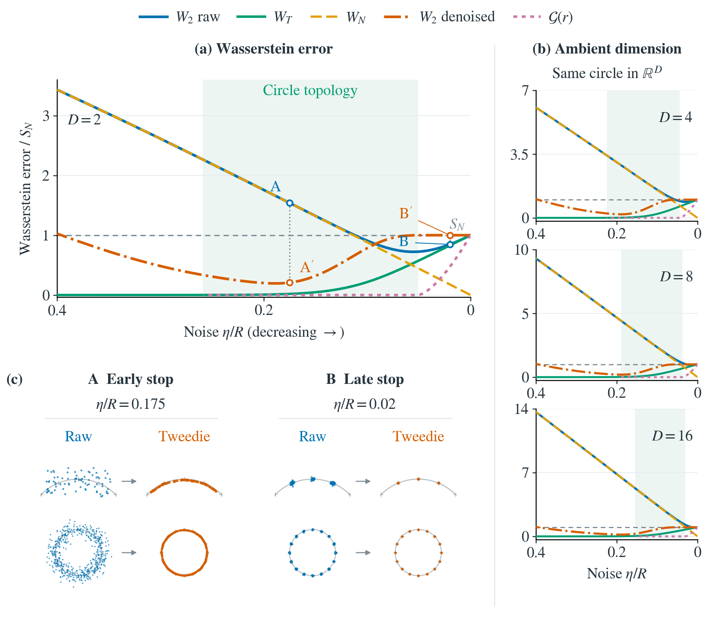

# Merged uniform-circle figure (2026-11-04)

This version accompanies the reorganized Section 4 of the manuscript. It merges
the earlier topology/error and stopping/denoising figures using a **uniform circle
target and 16 equally spaced training observations**. The historical Figure 2
and Figure 3 code and inputs remain in their original directories.

```sh
python -m pip install -r section_04_distribution/merged_uniform_20261104/requirements_uniform.txt
python run.py figure2-uniform
```

The command redraws cached synthetic measurements without rerunning transport.
See [REPRODUCE_UNIFORM.txt](REPRODUCE_UNIFORM.txt) for independent numerical
regeneration and [release_manifest.json](release_manifest.json) for hashes and
input roles. Rendering is 6 by 5.2 inches with STIX text at 9.2 pt; the right
column contains D=4,8,16, while the main panel shows D=2.

A is eta/R=0.175; B is eta/R=0.02, a late fragmented neighborhood where denoising
increases total error. Neither is a minimum-raw-error selection. The tiny
finite-grid denoised gain at B is unresolved and is described only as approximately
the empirical benchmark. The neighborhood topology is distinct from the full
support of the Gaussian mixture.


