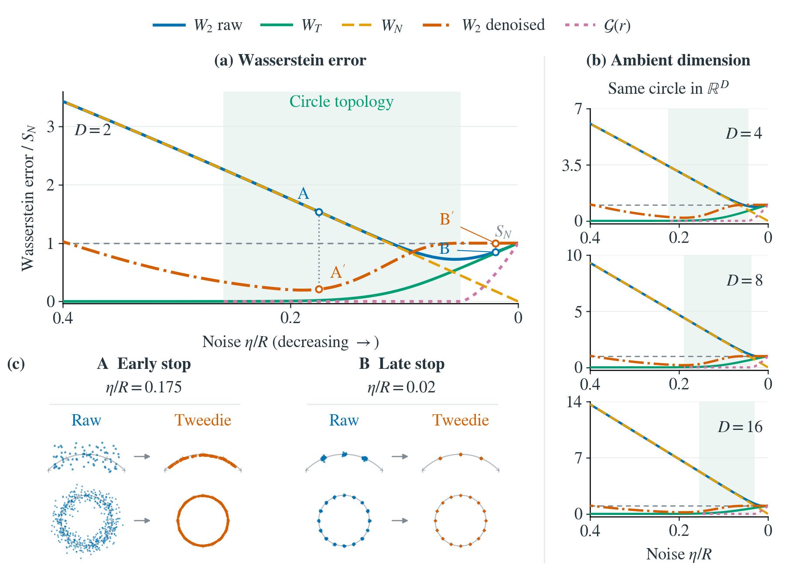

# Compact merged Figure 2 (2026-11-05)

This is a layout-only revision of the 2026-11-04 uniform-circle figure.
The target remains uniform on a circle, with 16 equispaced training sites.
All cached transport measurements, paired particles, A/B readouts, colors,
and 9.2 pt STIX typography are unchanged. The canvas is 6 x 4.35 inches
(previously 6 x 5.2); the lower-left snapshots have tighter spacing and
the right-column panels are shorter. The shared legend remains a single row.

```sh
python -m pip install -r section_04_distribution/merged_uniform_20261105/requirements_uniform.txt
python run.py figure2-uniform
```

This redraws frozen measurements, without repeating the transport computation.
For the numerical protocol and original regeneration commands, see
[the previous version](../merged_uniform_20261104/REPRODUCE_UNIFORM.txt).
`input_hashes.json` records the byte-identical inputs shared with that version.
All previous plotting code and outputs remain in their historical directories;
`python run.py figure2-uniform-20261104` reproduces the previous layout.

A is eta/R=0.175; B is eta/R=0.02. Neither is a minimum-raw-error selection.
Shading is the exact circle-topology interval for the calibrated closed-ball
neighborhood. It is not a certified total-error monotonicity interval.
The visually unresolved denoised deficit at B is not numerical proof of a gain.


